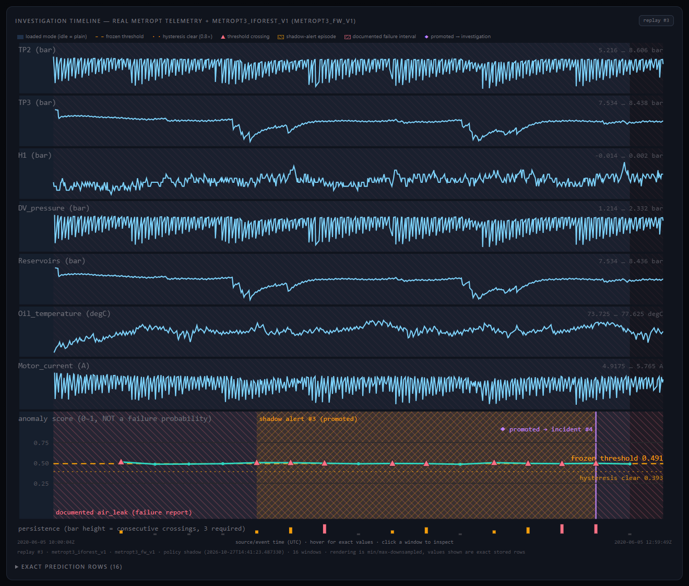
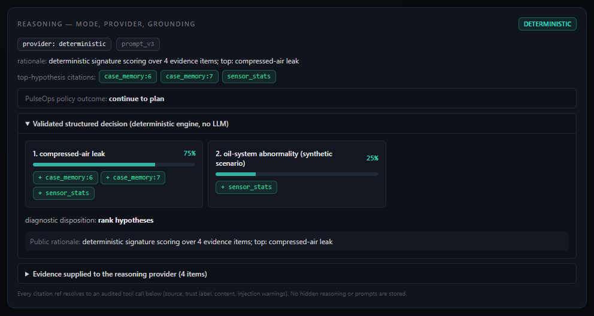
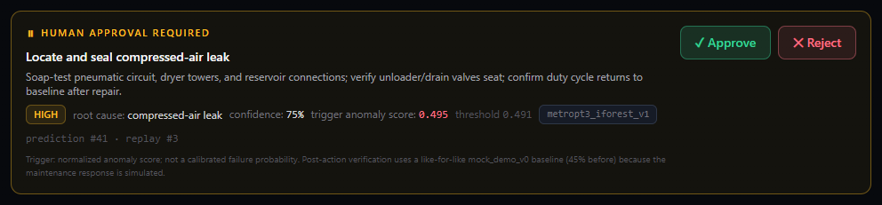
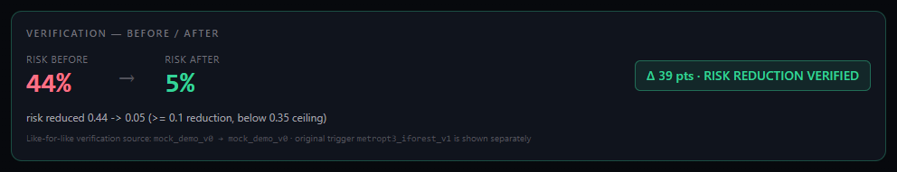
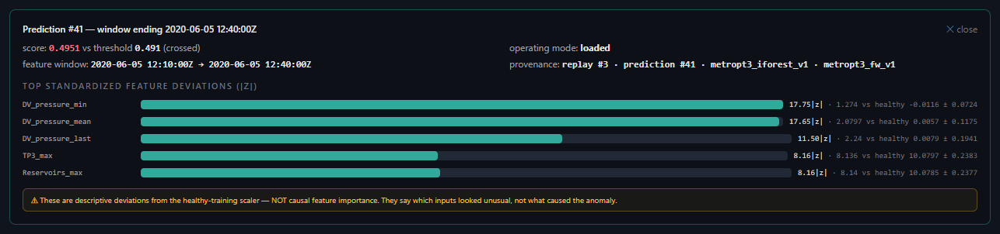
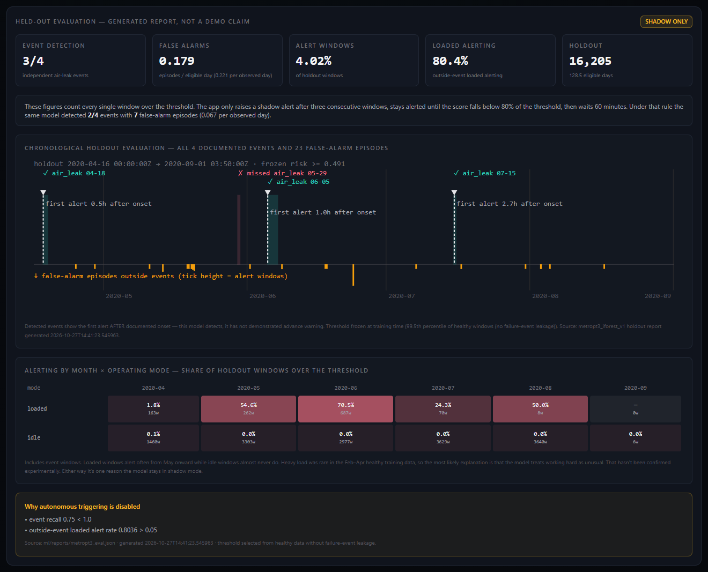
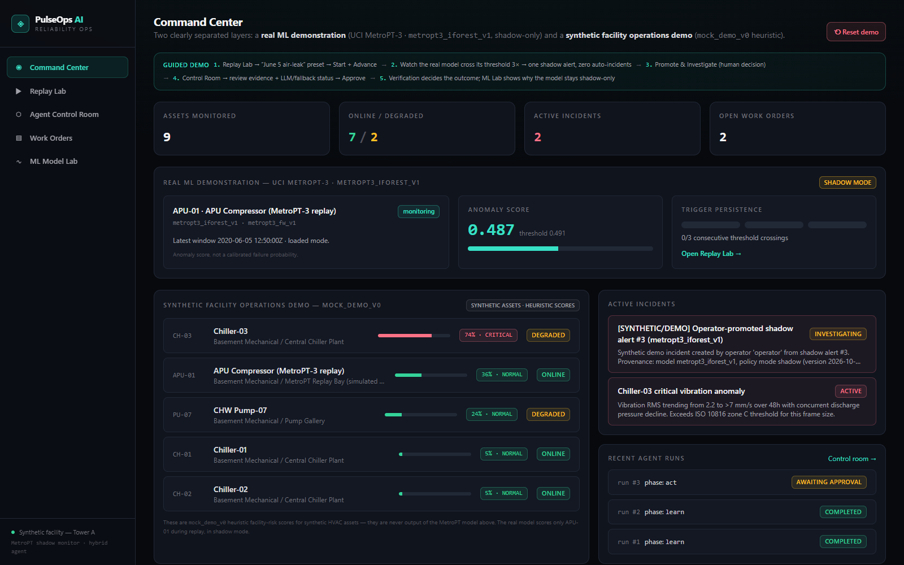

# PulseOps

Predictive maintenance usually stops at an alert. Someone still has to work
out what's wrong, decide what to do, get it approved, and check the fix
worked. PulseOps is a prototype of that whole path. It watches equipment
telemetry with an anomaly model, opens an investigation when a person decides
to, gathers evidence, ranks likely causes, proposes a maintenance action that a
person must approve, checks whether the problem actually improved, and only
then saves the case for next time.

```
Monitor → Investigate → Recommend → Human approves → Act → Verify → Learn
```

The anomaly model is trained on real compressor data from a metro train. It
detects abnormal behaviour; it doesn't predict failures in advance, and it
runs in shadow mode because it didn't pass the bar I set for automatic
alerting. More on that below.



## What's real and what isn't

| Part | Source |
|---|---|
| Compressor telemetry in the Replay Lab | Real: UCI MetroPT-3, replayed into the database on an accelerated clock |
| `metropt3_iforest_v1` scores | A real model trained on that data. An anomaly score, not a failure probability. Shadow mode only |
| Chillers, pumps and their risk scores | Synthetic, scored by a simple heuristic labelled `mock_demo_v0` |
| Incidents opened from shadow alerts | Created by a person and marked `[SYNTHETIC/DEMO]` |
| The effect of a repair | Simulated. The environment can respond with success, failure, no data, or a worse result |

## How it works

1. **Replay.** Historical telemetry is written to the database as if it were
   arriving live. Replaying the same period twice gives two independent runs.
2. **Score.** Every 10 minutes of source time, the app builds 30-minute
   feature windows from the database (using the same code as training) and
   scores them with the frozen model. It never retrains at runtime.
3. **Shadow alert.** Three consecutive windows over the threshold open a
   shadow alert. That records that the model would have raised an incident.
   Nothing else happens automatically.
4. **Investigate.** A person clicks *Promote & Investigate*. The agent checks
   case memory first, then sensors, records, manuals and the model output,
   with every tool call logged and labelled trusted or untrusted. It ranks
   the possible causes. If the top two are tied, it stops and asks for one
   specific independent measurement instead of guessing.
5. **Approve.** The agent proposes an action. Nothing executes until a
   person approves it; the server enforces this.
6. **Verify.** After the (simulated) repair, verification decides whether it
   passed, failed, was inconclusive, or made things worse. Failures re-plan
   with a fresh approval, or escalate.
7. **Learn.** Only a passed verification closes the incident and saves the
   case. The next similar investigation finds and cites it.

An LLM can optionally re-rank the causes, request evidence, or abstain. It
gets the evidence as escaped data, and its answer is checked against a strict
schema and the list of allowed causes and evidence references. Anything
invalid, or any provider error, falls back to the deterministic diagnosis.
The LLM can't propose, approve, or execute anything.

## Screenshots

The ranked diagnosis cites its evidence, including a confirmed earlier case
from memory:



Nothing runs until someone approves it. The card shows the exact model
reading that started the investigation:



After the simulated repair, verification compares before and after on the
same measure:



For any scored window you can see which inputs looked most unusual. That's
descriptive, not a claim about cause:



The Model Lab shows the evaluation, including the misses and where the false
alarms come from:



The Command Center keeps the real model and the synthetic facility apart:



## Model results

Trained on healthy data from February to mid-April 2020 and evaluated only on
the five months after that:

* Single-window alerts caught 3 of the 4 documented air leaks. The app's alert
  rule (three windows in a row) caught 2 of 4, with far fewer false alarms
  (about one every 15 days instead of one every 5).
* Every detection came after the leak had started, by 0.5 to 3 hours. So it's
  detection, not early warning.
* All false alarms happened while the compressor was working hard. Heavy load
  was rare in the training data, which is the most likely reason.

That's why the model stays in shadow mode. The full evaluation, including
baselines, is in the [model card](docs/model-card.md).

## Running it

You'll need Python 3.11+, Node 22+, and the MetroPT-3 dataset for the Replay
Lab (download steps in [`ml/datasets/README.md`](ml/datasets/README.md)). The
synthetic facility and the headless demo work without it.

```bash
# train the model once (needs the dataset)
pip install -e "ml[dev]"
python -m pulseops_ml.ingest && python -m pulseops_ml.train && python -m pulseops_ml.evaluate

# backend
cd apps/api
pip install -e ".[dev]"
python -m pulseops_api.init_db
python -m uvicorn pulseops_api.main:app --port 8000

# frontend (another terminal)
cd apps/web
npm install
npm run dev
```

Open http://localhost:3000 and follow the guided steps on the Command Center.
[`docs/demo-script.md`](docs/demo-script.md) walks through the main scenario.

Or run everything in containers with PostgreSQL:

```bash
docker compose up --build
```

Without the dataset, `python -m pulseops_api.demo_golden_path` (from
`apps/api`) runs the synthetic Chiller-03 investigation end to end in the
terminal.

## Repository layout

```
apps/api    FastAPI backend: agent loop, tools, replay, inference, shadow alerts, reasoning
apps/web    Next.js front end
ml          MetroPT-3 pipeline: ingest, train, evaluate, model artifacts, reports
eval        Scripted agent scenarios with safety gates
docs        Architecture, agent loop, security, model card, design decisions
```

[`CONTRIBUTING.md`](CONTRIBUTING.md) covers the design rules and how to run the
tests, linters and the eval harness. Further reading:
[architecture](docs/architecture.md),
[agent loop](docs/agentic-loop.md),
[security](docs/security.md),
[design decisions](docs/decisions.md),
[adding other data sources](docs/data-onboarding.md).

## Limitations

* The model detects; it doesn't predict. It found 2 to 3 of 4 failures, all
  air leaks, all after onset. Four events is too few to say much about
  accuracy.
* Repairs and their verification are simulated.
* On the real compressor data there are no manuals or maintenance records, so
  the diagnosis rests on sensor evidence and two candidate causes.
* There's no authentication. Anyone who can reach the API can approve an
  action. It's built to run locally.
* LLM support is tested in CI with fake providers. Live providers are
  optional and need your own API key.

## Data and license

Compressor data: [UCI MetroPT-3](https://archive.ics.uci.edu/dataset/791/metropt+3+dataset)
(Veloso et al.), used under
[CC BY 4.0](https://creativecommons.org/licenses/by/4.0/). Everything else in
the facility is synthetic; no company or customer data is used.

Code: © 2026 Ifzaal Ahamed Imdad, all rights reserved. You're welcome to read
it, but please ask before using any of it. See [LICENSE](LICENSE).
